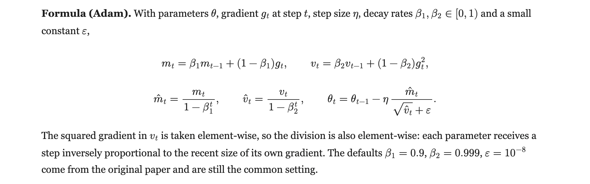
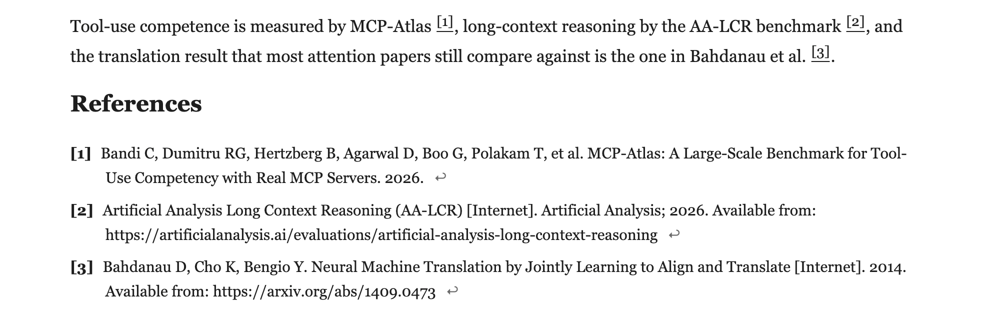
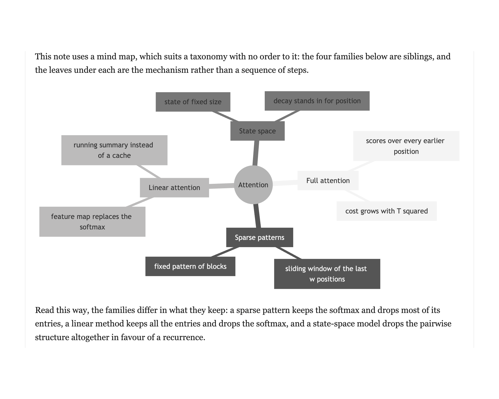
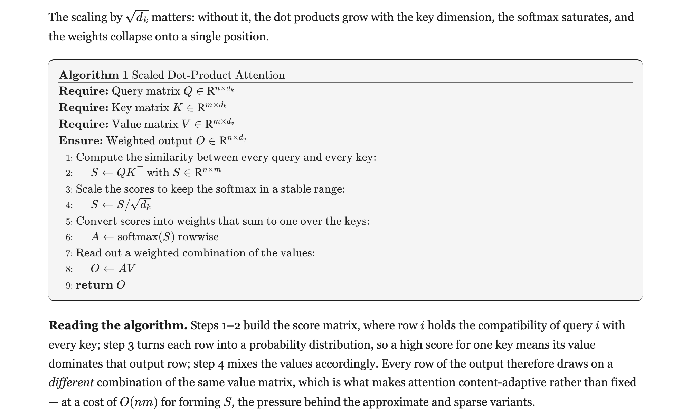
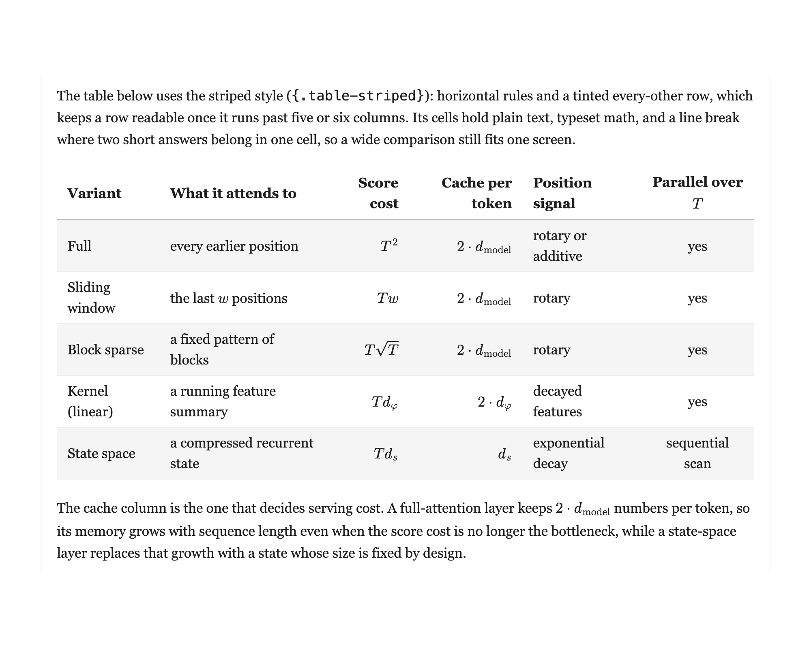
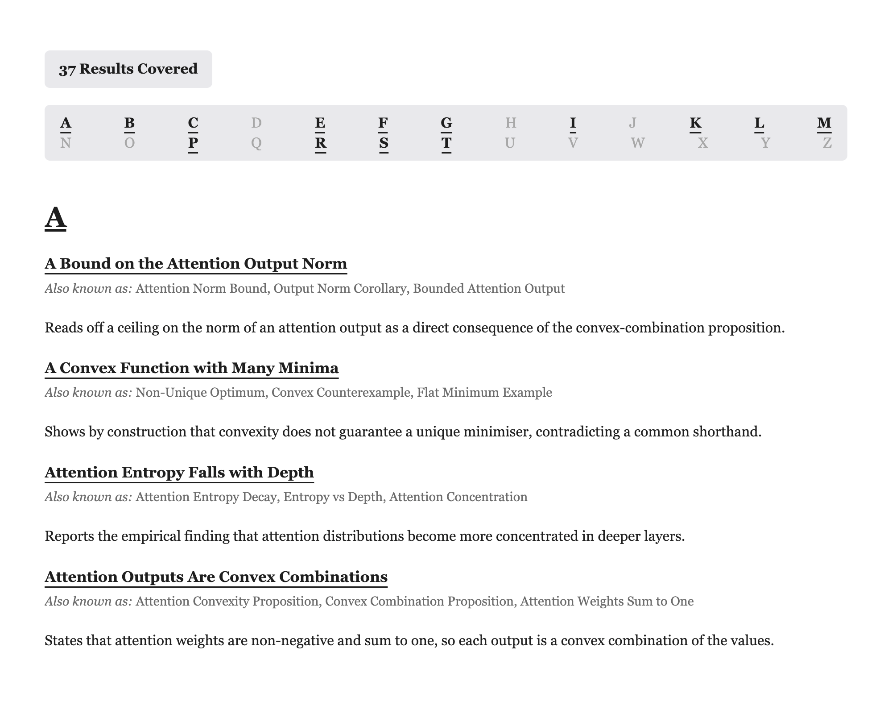
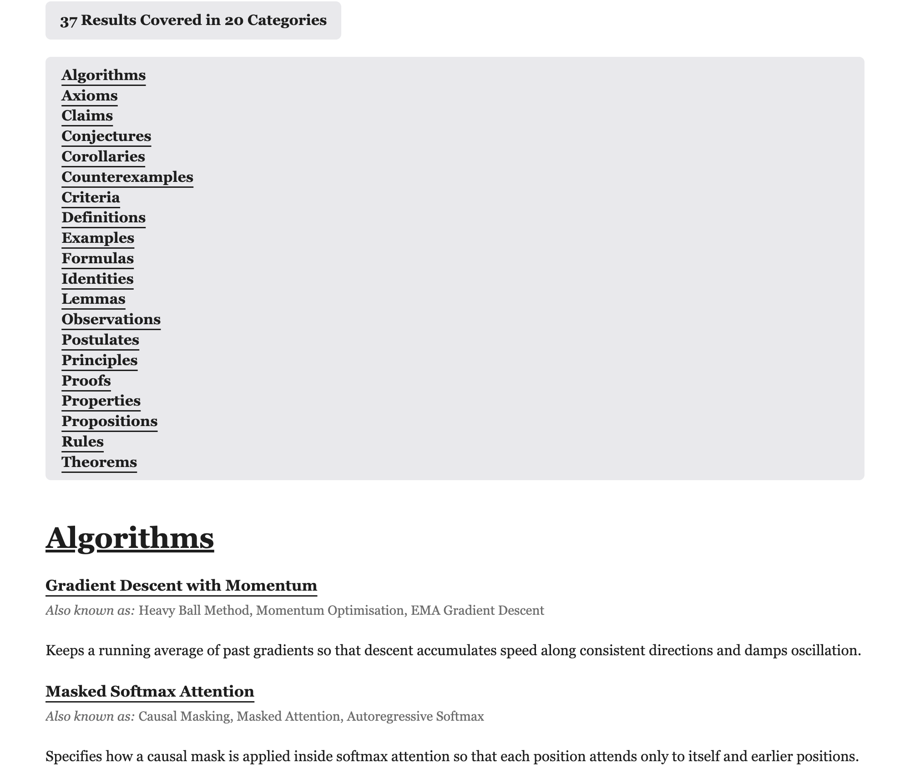

# SciDraft

**A Hugo theme for scientific writing, research notes, and academic publishing.**

SciDraft combines a clean, responsive reading experience with tools for mathematical and technical writing. Use one Markdown-based content workflow for short research notes, detailed articles, equations, citations, diagrams, and organized collections of related entries.

- **Live demo:** [www.zhumengyao.com/scidraft](https://www.zhumengyao.com/scidraft/)
- **Hugo requirement:** v0.158.0 or later
- **License:** [MIT](LICENSE)
- **Upstream theme:** [hugo-PaperMod](https://github.com/adityatelange/hugo-PaperMod), substantially extended and customized for scientific writing

## Features

- **Scientific writing:** Markdown-based research notes and long-form articles
- **Mathematics:** KaTeX-rendered mathematical expressions
- **References:** BibTeX-based citations
- **Diagrams:** Mermaid diagram support
- **Algorithms and tables:** Specialized presentation for pseudo-algorithms and table styles
- **Research indexes:** A–Z and category-based entry maps for organized collections
- **Search:** Search interface for navigating published content
- **Reading experience:** Responsive layout, table of contents, breadcrumbs, reading time, and word count
- **Navigation and discovery:** Related posts, post navigation, RSS, and sharing features
- **Appearance:** Light and dark modes

See the [live demo](https://www.zhumengyao.com/scidraft/) for examples of these features.

## Feature showcase

These screenshots show SciDraft's scientific writing and research-navigation features in the bundled example site. The note content is demonstration material, not a scientific reference.

### Mathematics

Combine inline mathematical notation with displayed equations in research notes and articles.



[Explore the mathematics example](https://www.zhumengyao.com/scidraft/notes/demo-note-formula-adam/).

### BibTeX-based citations

Render numbered in-text citations and a bibliography from a note's BibTeX file, with links between citations and reference entries.



[Explore the citations example](https://www.zhumengyao.com/scidraft/notes/demo-note-third-bibliography-benchmarks/).

### Mermaid diagrams

Describe diagrams in Markdown and render them alongside the discussion. This example uses a mind map to organize attention methods.



[Explore the diagram example](https://www.zhumengyao.com/scidraft/notes/demo-note-mermaid-mindmap-attention/).

### Algorithms

Present pseudocode with an algorithm caption, numbered steps, input and output declarations, and mathematical notation.



[Explore the algorithm example](https://www.zhumengyao.com/scidraft/notes/demo-note-attention-pseudocode/).

### Scientific tables

Compare methods using styled tables with mathematical expressions, multiline cells, and alternating row backgrounds.



[Explore the table example](https://www.zhumengyao.com/scidraft/notes/demo-note-attention-variants-table/).

### A–Z entry map

Browse entries alphabetically using letter navigation, linked titles, alternative names, and concise summaries.



[Explore the A–Z entry map](https://www.zhumengyao.com/scidraft/math-a-to-z/).

### Category-based entry map

Group entries by result family or subject, with category navigation and links to the corresponding notes.



[Explore the category-based entry map](https://www.zhumengyao.com/scidraft/math-categories/).

## Requirements

- [Hugo](https://gohugo.io/installation/) **v0.158.0 or later**
- [Git](https://git-scm.com/) for installation and updates

Check your installed Hugo version:

```bash
hugo version
```

## Installation

### 1. Create a Hugo site

If you do not already have a site, create one:

```bash
hugo new site my-research-site
cd my-research-site
```

### 2. Install SciDraft

Clone the theme into your site's `themes` directory:

```bash
mkdir -p themes
git clone https://github.com/mengyaozhu/scidraft.git themes/scidraft
```

### 3. Enable the theme

In your site's `hugo.toml`, set:

```toml
theme = "scidraft"
```

**Important:** SciDraft uses configuration for features such as mathematical rendering and search that may need to be defined in your site's configuration. Review `exampleSite/hugo.toml` and copy the settings you need rather than assuming all demo configuration is inherited automatically.

### 4. Add content and run your site

Create Markdown content in your own site's `content/` directory, then start the development server:

```bash
hugo server
```

Open the local URL printed by Hugo to preview your site.

Your content belongs to your site—not to the theme's `exampleSite/` directory.

## Configuration and examples

SciDraft includes a complete demonstration site in [`exampleSite/`](exampleSite/). Use it as the reference for:

- Theme and site configuration
- Mathematical notation and scientific content
- Citations, diagrams, and specialized content blocks
- Entry indexes and category-based collections
- Menus and other presentation options

Start with [`exampleSite/hugo.toml`](exampleSite/hugo.toml) and the example content before adapting the settings to your own website.

## Updating SciDraft

If you installed the theme by cloning the repository directly, run:

```bash
cd themes/scidraft
git pull
```

Review upstream changes before updating a production site, particularly if you have customized theme files or overridden templates.

## Customization

For maintainability, keep your site's content, configuration, assets, and template overrides in your own Hugo project whenever possible. Avoid modifying the theme directly unless you intend to maintain a customized fork.

## Credits

SciDraft builds on [hugo-PaperMod](https://github.com/adityatelange/hugo-PaperMod) by Aditya Telange, with substantial extensions and customizations for scientific and research-oriented publishing.

## License

SciDraft is distributed under the [MIT License](LICENSE). Review the license file for the applicable terms and notices.